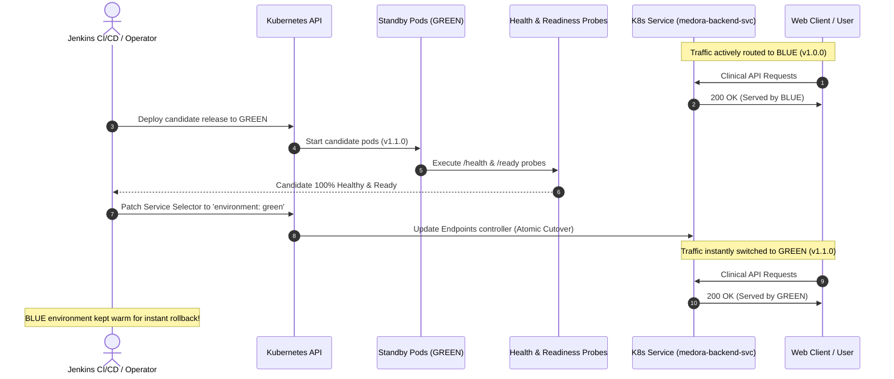

# MEDORA — Automated Blue-Green Zero-Downtime Deployment

This document explains the theory, implementation, and verification of the automated Blue-Green Deployment strategy implemented in MEDORA, satisfying **PBL-III Objective 2**.

---

## 1. Problem Statement & Motivation

In traditional in-place deployment strategies:
1. Application containers are stopped or replaced sequentially, causing temporary request dropping or latency spikes.
2. If the new release has an unhandled bug or database incompatibility, rolling back requires redeploying the old build, resulting in prolonged downtime.

In mission-critical healthcare operations platforms like MEDORA:
- Clinical appointments cannot be dropped mid-booking.
- Doctor consultation notes and electronic health records must remain 100% accessible 24/7/365.
- Zero-Downtime Blue-Green deployment guarantees seamless upgrades with instant failover safety.

---

## 2. Blue-Green Deployment Mechanics

### Architectural Definitions
- **BLUE Environment**: The currently active, live production environment serving 100% of production traffic (Version `1.0.0`).
- **GREEN Environment**: The idle / staging candidate environment where the new release (Version `1.1.0`) is deployed and tested before traffic cutover.
- **Routing Service**: A Kubernetes `Service` (`medora-backend-svc` and `medora-frontend-svc`) that uses label selectors to direct traffic to either `environment: blue` or `environment: green`.



---

## 3. Step-by-Step Rollout Workflow

1. **Active Environment Detection**:
   The script inspects the selector on `medora-backend-svc`:
   ```bash
   CURRENT_ENV=$(kubectl get svc medora-backend-svc -n medora -o jsonpath='{.spec.selector.environment}')
   ```
2. **Candidate Selection**:
   If current is `blue`, candidate is `green`. If current is `green`, candidate is `blue`.
3. **Candidate Manifest Deployment**:
   Deploy candidate pods to the inactive environment:
   ```bash
   kubectl apply -f k8s/green/backend-deployment-green.yaml -n medora
   kubectl apply -f k8s/green/frontend-deployment-green.yaml -n medora
   ```
4. **Readiness Probe Synchronization**:
   Wait until all candidate replicas report `Ready: 1/1`:
   ```bash
   kubectl rollout status deployment/medora-backend-green -n medora --timeout=90s
   ```
5. **Synthetic Health Smoke Test**:
   Execute synthetic probe against candidate pod:
   ```bash
   kubectl exec -n medora <candidate-pod> -- curl -sf http://localhost:8000/ready
   ```
6. **Atomic Traffic Cutover**:
   Patch the Kubernetes Service selector in a single atomic transaction:
   ```bash
   kubectl patch svc medora-backend-svc -n medora -p '{"spec":{"selector":{"environment":"green"}}}'
   kubectl patch svc medora-frontend-svc -n medora -p '{"spec":{"selector":{"environment":"green"}}}'
   ```
7. **Post-Cutover Verification**:
   Verify client requests return the candidate version (`v1.1.0`) and HTTP 200 OK.
8. **Retention for Instant Rollback**:
   The previous `blue` deployment remains running in the background. If any unexpected error occurs within the evaluation window, rollback takes less than 1 second.

---

## 4. Zero-Downtime Rollback Procedure

If an anomaly is detected post-deployment, executing an instant rollback requires updating the Service selector back to the previous environment:

```bash
# Execute automated rollback
./jenkins/scripts/rollback.sh

# Or direct kubectl patch:
kubectl patch svc medora-backend-svc -n medora -p '{"spec":{"selector":{"environment":"blue"}}}'
kubectl patch svc medora-frontend-svc -n medora -p '{"spec":{"selector":{"environment":"blue"}}}'
```

Because the original pods were kept running, cutover back to `blue` occurs instantaneously without waiting for containers to boot or warm up caches.

---

## 5. Live Demonstration in Viva Examination

1. Open MEDORA at `http://localhost:3000` (or your EC2 IP).
2. Navigate to **DevOps Control Centre** (`/devops`).
3. Notice the **Active Production** glowing pill is `BLUE ACTIVE`.
4. Click the button: **"Switch Traffic to GREEN (Candidate)"**.
5. Observe the live transition:
   - Traffic cutover notification appears.
   - The indicator switches to `GREEN ACTIVE`.
   - The version updates from `v1.0.0` to `v1.1.0`.
   - All appointments and patient records persist seamlessly without refreshing or losing session state!
